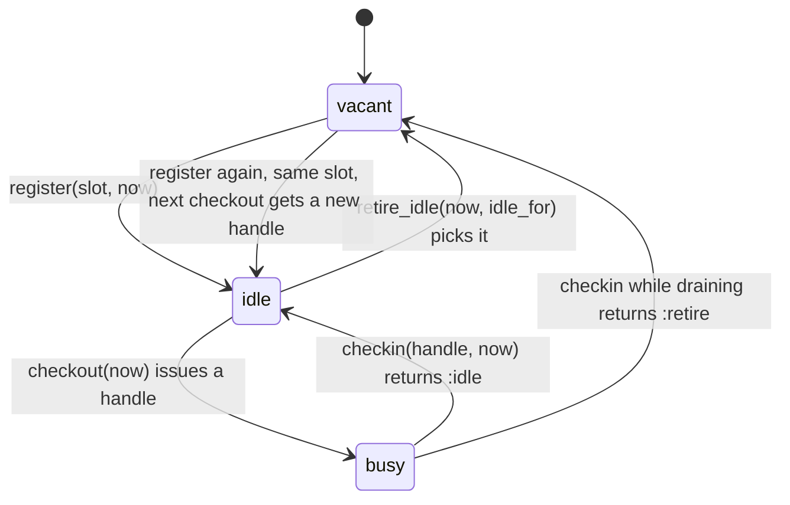
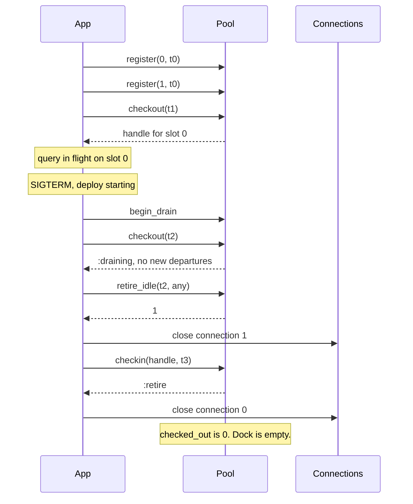

# PoolMachines

> A connection returned twice is a connection somebody else is now using. 🛠️

A resource pool ledger for Ruby. You register the slots you've built, check them out, check them in, and ask which idle ones are old enough to tear down. The `Pool` never opens a socket or closes a file. It keeps the roster: which slot is busy, which is idle and since when, and whether the handle you just returned is the one it issued or a stale copy from an earlier trip.

## Quick Start

```bash
gem 'pool_machines'
```

```ruby
pool = PoolMachines::Pool.new
now  = -> { Process.clock_gettime(Process::CLOCK_MONOTONIC, :nanosecond) }

# You build the connection. The pool just learns that slot 0 is serviceable.
connections[0] = PG.connect(db_url)
pool.register(0, now.call)         # => :registered

# Each request borrows a slot and gives it back.
handle = pool.checkout(now.call)   # => PoolMachines::Handle, or nil when none is idle
connections[handle.slot].exec(sql)
pool.checkin(handle, now.call)     # => :idle

# On a quiet night, tear down whatever has sat idle for five minutes.
while (slot = pool.retire_idle(now.call, 5 * 60 * 1_000_000_000)).is_a?(Integer)
  connections.delete(slot).close
end
```

Times are Integer nanoseconds from a monotonic clock, instants and spans alike. Slots are the integers 0 through 31. Every call answers with a value: what it did, or a symbol naming why it did nothing.

## A Message to the Resistance

So you wrote a connection pool. Everyone has. An array of connections, a mutex, `pop` on the way out, `push` on the way back. It worked for a year.

Then a request timed out mid-query, the rescue block pushed the connection back, the ensure block pushed it back again, and for the next six hours two threads shared one socket. The errors made no sense because the errors belonged to someone else's query.

The bug isn't the array. The bug is that a bare connection object can't tell you whether it's already been returned. The thing you push back has to carry a receipt, and the pool has to refuse a receipt it has already stamped. This gem is the receipt book. Your connections stay yours.

## Chapter 1: Stardate 2025.186, the AMS Little

> **AMS Little**, NCC-4214, *Little*-class service tender.
> Do not fabricate a new warp core for every departure.

The tender doesn't build engines. It keeps the dock roster: thirty-two bays, which are occupied, which hold a serviced core waiting for a ship, and how long each has waited. A crew that brings a core back gets a fresh bay ticket. A crew that turns up with last week's ticket is turned away, because that bay has been issued to someone else since.

Somewhere on the dock, a cadet proposes:

```ruby
def with_connection
  conn = @free.pop || PG.connect(db_url)
  yield conn
rescue => e
  @free.push(conn)   # give it back on error
  raise
ensure
  @free.push(conn)   # and also give it back always
end
```

"That," says the dockmaster, "is how two ships leave on one core."

## The Flight Plan

Every slot is in exactly one state. Draining is a property of the whole pool.



And the deploy where the old pool was drained:



## How the Dock Works

### Register and check out

```ruby
pool = PoolMachines::Pool.new
pool.checkout(0)          # => nil, nothing registered yet

pool.register(0, 1)       # => :registered
pool.register(0, 1)       # => :already_idle, it's on the roster and nothing changed

handle = pool.checkout(2)
handle.slot               # => 0
pool.checked_out          # => 1
pool.register(0, 3)       # => :busy, that bay is out
pool.register(32, 3)      # => :unknown_slot
```

`checkout` returns `nil` when no registered slot is idle. It never blocks and never builds anything. If you want to grow the pool, build a resource and `register` a free slot number.

Registering a slot that already holds an idle resource is a repeat, not a mistake: the roster already says what you asked for, so the answer is `:already_idle` and nothing moves, not even the time it went idle.

### Check in, and the receipt that only works once

A handle is good for exactly one `checkin`. Return it and the slot goes idle. Return it again and the pool answers `:stale`, because the slot may already belong to a newer handle.

```ruby
pool = PoolMachines::Pool.new
pool.register(0, 1)

first = pool.checkout(2)
pool.checkin(first, 3)    # => :idle

second = pool.checkout(4) # same slot 0, new receipt
pool.checkin(first, 5)    # => :stale, that receipt is spent
pool.checkin(second, 5)   # => :idle
```

That's the double-push bug from the cadet's code, caught at the second push instead of six hours later. The second push is not honoured as a repeat: once a checkout is returned the pool keeps nothing about it, so it can't tell your retry from somebody's stale copy. Check the answer.

### Retire what's been sitting

`retire_idle` hands you one slot per call: an idle slot that has been idle for at least `idle_for` nanoseconds. It returns `nil` when nothing qualifies. Loop while it answers an Integer, closing as you go.

```ruby
pool = PoolMachines::Pool.new
pool.register(0, 0)
pool.register(1, 0)

pool.retire_idle(2, 3)    # => nil, idle for 2, needs 3
pool.retire_idle(10, 5)   # => 0
pool.retire_idle(10, 5)   # => 1
pool.retire_idle(10, 5)   # => nil

pool.register(0, 11)      # => :registered, the slot is vacant again
```

A busy slot is never retired. The pool will tell you to close it when it comes back.

### Drain

`begin_drain` flips the pool into wind-down. No more registrations, no more checkouts. Idle slots retire regardless of how long they've been idle. Busy slots keep working, and when each one is checked in the answer is `:retire` instead of `:idle`, which is your cue to close it.

```ruby
pool = PoolMachines::Pool.new
pool.register(0, 0)
pool.register(1, 0)
handle = pool.checkout(1)

pool.begin_drain          # => :begun
pool.begin_drain          # => :already_draining
pool.checkout(3)          # => :draining
pool.register(2, 3)       # => :draining
pool.retire_idle(3, 100)  # => 1, idle_for is ignored while draining
pool.checkin(handle, 4)   # => :retire
pool.checked_out          # => 0
```

Drain never yanks a resource out from under a running query. It only refuses new work and tells you what to close as work finishes.

### The clock only moves forward

You pass `now` on every call. The pool remembers the latest time an honoured call showed it and refuses anything earlier with `:time_regression`.

```ruby
pool = PoolMachines::Pool.new
pool.register(0, 5)
pool.register(1, 3)       # => :time_regression
pool.register(9_000, 999) # => :unknown_slot
pool.register(1, 5)       # => :registered, the refusals above didn't touch the clock
```

A refusal never moves the clock. An honoured call does, and that includes the two that can come back empty-handed: `checkout` answering `nil` means "nothing was idle at `now`", and `retire_idle` answering `nil` means "nothing was old enough at `now`". Both are answers about that instant, so the pool holds you to it afterwards.

```ruby
pool = PoolMachines::Pool.new
pool.checkout(10)         # => nil, honoured: nothing idle at 10
pool.register(0, 9)       # => :time_regression
```

Use a monotonic clock. Wall clocks jump.

### Scopes

A handle is only meaningful to the pool that issued it. Run more than one pool and each needs its own scope, an Integer in `0..65535` that every handle it issues carries:

```ruby
primary = PoolMachines::Pool.with_scope(1)
replica = PoolMachines::Pool.with_scope(2)
primary.register(0, 0)
replica.register(0, 0)

handle = primary.checkout(1)
handle.scope                  # => 1
replica.checkin(handle, 2)    # => :stale, not one of mine
primary.checkin(handle, 2)    # => :idle
```

`Pool.new` is scope zero. The pool can't pick a scope for you: it reads no clock and rolls no dice. Leave two pools in the same scope and they issue the same handles, so one will happily accept the other's receipt.

A restarted pool counts from one again, so a handle that outlived the restart could name a new checkout. Resume from a saved count with `Pool.resumed(scope, pool.issued)`, or give each incarnation a new scope. `resumed` brings back the handle sequence and nothing else: every slot is vacant, earlier handles are `:stale`, and an `issued` above 2**48-1 raises `RangeError`.

### What each call answers

| Call | Honoured | Refused, nothing changed |
| --- | --- | --- |
| `register(slot, now)` | `:registered`, or `:already_idle` for a slot already holding an idle resource (nothing changed) | `:draining`, `:time_regression`, `:unknown_slot`, `:busy` |
| `checkout(now)` | a `Handle`, or `nil` when nothing is idle; both record `now` | `:draining`, `:time_regression`, `:exhausted` |
| `checkin(handle, now)` | `:idle` (keep it) or `:retire` (close it) | `:stale`, `:time_regression` |
| `begin_drain` | `:begun`, or `:already_draining` (nothing changed) | never refuses |
| `retire_idle(now, idle_for)` | the retired slot (Integer), or `nil` when nothing is old enough; both record `now` | `:time_regression` |
| `checked_out`, `capacity`, `scope`, `issued`, `draining?` | the value | queries, never refuse |

`register` checks in that order: a draining pool answers `:draining` whatever the slot. `:exhausted` means this pool has issued all 2**48-1 handles of its scope; none is ever reissued. Every refusal has its own symbol; there is no catch-all.

## The Rules of the Tender

- **32 slots, numbered 0 to 31.** `Pool::CAPACITY` and `pool.capacity` say so. Slot 32, or any other Integer that names no slot, is `:unknown_slot`.
- **Every number is an Integer.** Slots, times, and durations; times and durations are nanoseconds. Floats, strings, nil, and NaN raise `TypeError`. Negative values and values at or above `2**64` raise `RangeError`.
- **Refusals don't raise, and don't change anything.** `:draining`, `:time_regression`, `:unknown_slot`, `:busy`, `:exhausted`, and `:stale` are answers. Not a slot, not a checkout, not an issued handle, not the clock moves on a refusal. Only malformed input raises.
- **Repeats.** `register` on a slot that is already idle is `:already_idle` and `begin_drain` on a draining pool is `:already_draining`: the pool can see the effect already holds. A second `checkin` is `:stale`: the pool keeps no history of a returned checkout, so it can't prove the repeat.
- **Handles are opaque and single-use.** You can't construct one or `dup` one. A spent handle, or one from a pool in another scope, is `:stale`.
- **Scopes.** Give each pool its own with `Pool.with_scope(scope)`; the core cannot pick one. Two pools in the same scope issue the same handles.
- **Restarts.** Resume from a saved count with `Pool.resumed(scope, issued)`, or give each incarnation a new scope. `resumed` restores the handle sequence only; registering the resources again is yours.
- **Frozen means frozen.** `freeze` the pool and `register`, `checkout`, `checkin`, `begin_drain`, and `retire_idle` raise `FrozenError`. The queries still answer.

## What You Think You're Doing vs Reality

### You Think: "The ensure block guarantees the connection goes back."
### Reality: The ensure block guarantees it goes back at least once.

`ensure` runs after `rescue`. If both return the connection, it's returned twice, and a plain array can't tell. A pool that issues receipts can, and answers `:stale` to the second one on the spot.

## What's Yours

The pool holds slot numbers and timestamps, nothing else. You create the real resource before `register`, keep it somewhere indexed by slot, and close it when `retire_idle` or a `:retire` check-in says so. Health checks, waiting for a free slot, and persistence across restarts are all outside the roster: the one thing worth saving is `issued`, so a restarted pool doesn't hand out an old receipt number again. Serialize calls to one pool; it doesn't lock for you.

## License

MIT License. See [LICENSE.txt](LICENSE.txt) for details.

**Remember: The second `push` always looks harmless. The receipt book is what makes it fail where you can see it.**
