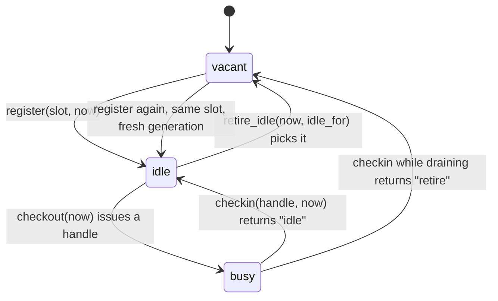
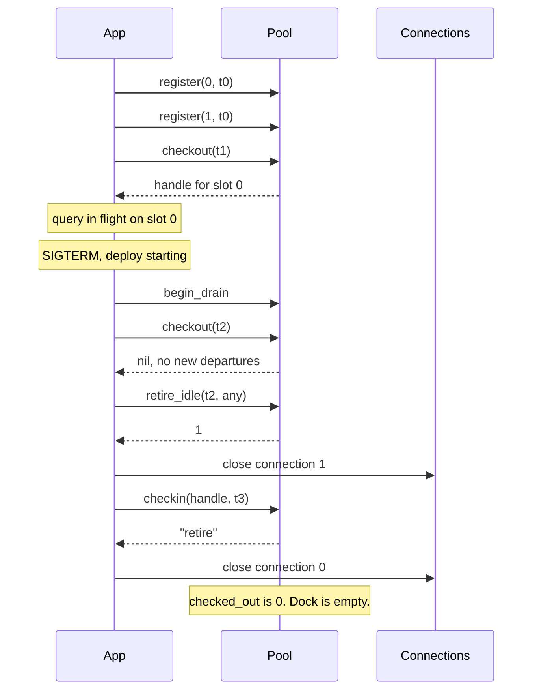

# PoolMachines

> A connection returned twice is a connection somebody else is now using. 🛠️

A resource pool ledger for Ruby. You register the slots you've built, check them out, check them in, and ask which idle ones are old enough to tear down. The `Pool` never opens a socket or closes a file. It keeps the roster: which slot is busy, which is idle and since when, and whether the handle you just returned is the one it issued or a stale copy from an earlier trip.

## Quick Start

```bash
gem 'pool_machines'
```

```ruby
pool = PoolMachines::Pool.new
now  = -> { Process.clock_gettime(Process::CLOCK_MONOTONIC, :nanosecond) }

# You build the connection. The pool just learns that slot 0 is serviceable.
connections[0] = PG.connect(db_url)
pool.register(0, now.call)         # => true

# Each request borrows a slot and gives it back.
handle = pool.checkout(now.call)   # => PoolMachines::Handle, or nil when none is free
connections[handle.slot].exec(sql)
pool.checkin(handle, now.call)     # => "idle"

# On a quiet night, tear down whatever has sat idle for five minutes.
while (slot = pool.retire_idle(now.call, 5 * 60 * 1_000_000_000))
  connections.delete(slot).close
end
```

Times are nanoseconds from a monotonic clock. Slots are the integers 0 through 31.

## A Message to the Resistance

So you wrote a connection pool. Everyone has. An array of connections, a mutex, `pop` on the way out, `push` on the way back. It worked for a year.

Then a request timed out mid-query, the rescue block pushed the connection back, the ensure block pushed it back again, and for the next six hours two threads shared one socket. The errors made no sense because the errors belonged to someone else's query.

The bug isn't the array. The bug is that a bare connection object can't tell you whether it's already been returned. The thing you push back has to carry a receipt, and the pool has to refuse a receipt it has already stamped. This gem is the receipt book. Your connections stay yours.

## Chapter 1: Stardate 2025.186, the AMS Little

> **AMS Little**, NCC-4214, *Little*-class service tender.
> Do not fabricate a new warp core for every departure.

The tender doesn't build engines. It keeps the dock roster: thirty-two bays, which are occupied, which hold a serviced core waiting for a ship, and how long each has waited. A crew that brings a core back gets a fresh bay ticket. A crew that turns up with last week's ticket is turned away, because that bay has been issued to someone else since.

Somewhere on the dock, a cadet proposes:

```ruby
def with_connection
  conn = @free.pop || PG.connect(db_url)
  yield conn
rescue => e
  @free.push(conn)   # give it back on error
  raise
ensure
  @free.push(conn)   # and also give it back always
end
```

"That," says the dockmaster, "is how two ships leave on one core."

## The Flight Plan

Every slot is in exactly one state. Draining is a property of the whole pool.



And the deploy where the old pool was drained:



## How the Dock Works

### Register and check out

```ruby
pool = PoolMachines::Pool.new
pool.checkout(0)          # => nil, nothing registered yet

pool.register(0, 1)       # => true
pool.register(0, 1)       # => false, already on the roster

handle = pool.checkout(2)
handle.slot               # => 0
pool.checked_out          # => 1
```

`checkout` returns `nil` when every registered slot is busy. It never blocks and never builds anything. If you want to grow the pool, build a resource and `register` a free slot number.

### Check in, and the receipt that only works once

A handle is good for exactly one `checkin`. Return it and the slot goes idle. Return it again and the pool raises, because the slot may already belong to a newer handle.

```ruby
pool = PoolMachines::Pool.new
pool.register(0, 1)

first = pool.checkout(2)
pool.checkin(first, 3)    # => "idle"

second = pool.checkout(4) # same slot 0, new receipt
pool.checkin(first, 5)    # raises ArgumentError, that receipt is spent
pool.checkin(second, 5)   # => "idle"
```

That's the double-push bug from the cadet's code, caught at the second push instead of six hours later.

### Retire what's been sitting

`retire_idle` hands you one slot per call: an idle slot that has been idle for at least `idle_for` nanoseconds. It returns `nil` when nothing qualifies. Loop until `nil`, closing as you go.

```ruby
pool = PoolMachines::Pool.new
pool.register(0, 0)
pool.register(1, 0)

pool.retire_idle(2, 3)    # => nil, idle for 2, needs 3
pool.retire_idle(10, 5)   # => 0
pool.retire_idle(10, 5)   # => 1
pool.retire_idle(10, 5)   # => nil

pool.register(0, 11)      # => true, the slot is vacant again
```

A busy slot is never retired. The pool will tell you to close it when it comes back.

### Drain

`begin_drain` flips the pool into wind-down. No more registrations, no more checkouts. Idle slots retire regardless of how long they've been idle. Busy slots keep working, and when each one is checked in the answer is `"retire"` instead of `"idle"`, which is your cue to close it.

```ruby
pool = PoolMachines::Pool.new
pool.register(0, 0)
pool.register(1, 0)
handle = pool.checkout(1)

pool.begin_drain
pool.checkout(3)          # => nil
pool.register(2, 3)       # => false
pool.retire_idle(3, 100)  # => 1, idle_for is ignored while draining
pool.checkin(handle, 4)   # => "retire"
pool.checked_out          # => 0
```

Drain never yanks a resource out from under a running query. It only refuses new work and tells you what to close as work finishes.

### The clock only moves forward

You pass `now` on every call. The pool remembers the latest time it has seen and treats anything earlier as a non-event: `register` returns `false`, `checkout` returns `nil`, `checkin` raises.

```ruby
pool = PoolMachines::Pool.new
pool.register(0, 5)
pool.register(1, 3)       # => false, time went backwards
```

Use a monotonic clock. Wall clocks jump.

## The Rules of the Tender

- **32 slots, numbered 0 to 31.** Slot 32 or a negative slot raises `RangeError`.
- **Every number is an Integer.** Slots, times, and durations. Floats, strings, and NaN raise `TypeError`. Values at or above `2**64` raise `RangeError`.
- **Handles are opaque and single-use.** You can't construct one, `dup` one, or hand one to a different pool. A spent or foreign handle raises `ArgumentError` on `checkin`.
- **Rejections are quiet, misuse is loud.** A duplicate `register`, a backwards clock, or an empty pool returns `false` or `nil`. A bad handle or a bad type raises.
- **Frozen means frozen.** `freeze` the pool and every mutating call raises `FrozenError`. `checked_out` still answers.

## What You Think You're Doing vs Reality

### You Think: "The ensure block guarantees the connection goes back."
### Reality: The ensure block guarantees it goes back at least once.

`ensure` runs after `rescue`. If both return the connection, it's returned twice, and a plain array can't tell. A pool that issues receipts can, and refuses the second one on the spot.

## What's Yours

The pool holds slot numbers and timestamps, nothing else. You create the real resource before `register`, keep it somewhere indexed by slot, and close it when `retire_idle` or a `"retire"` check-in says so. Health checks, waiting for a free slot, and persistence across restarts are all outside the roster. Serialize calls to one pool; it doesn't lock for you.

## License

MIT License. See [LICENSE.txt](LICENSE.txt) for details.

**Remember: The second `push` always looks harmless. The receipt book is what makes it fail where you can see it.**
